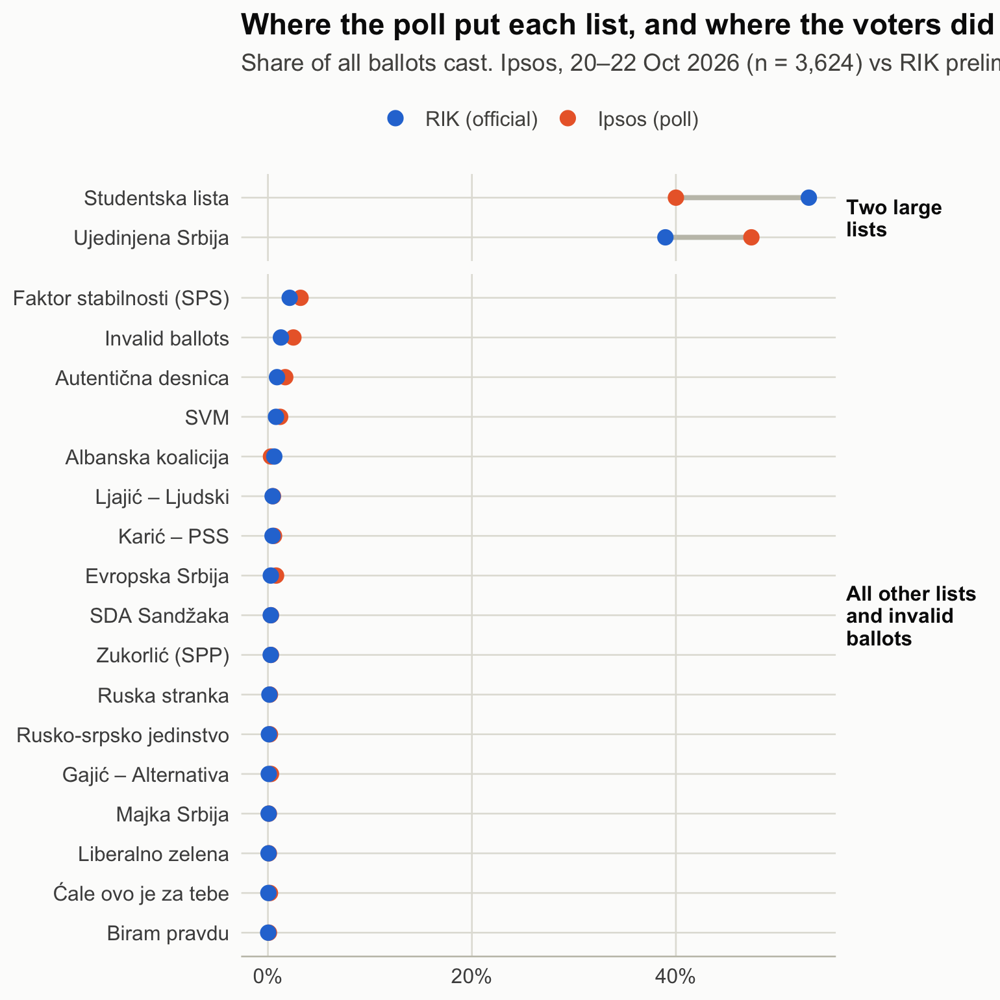
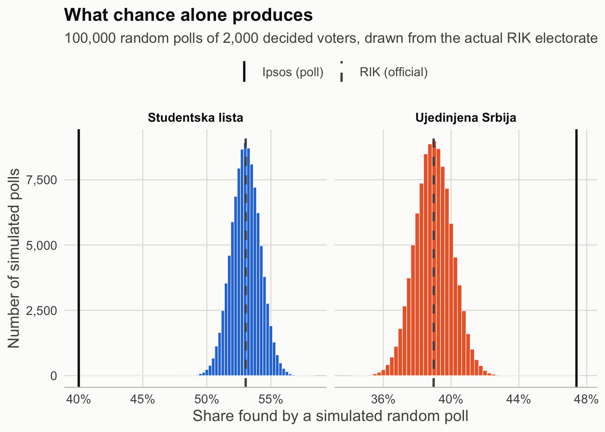
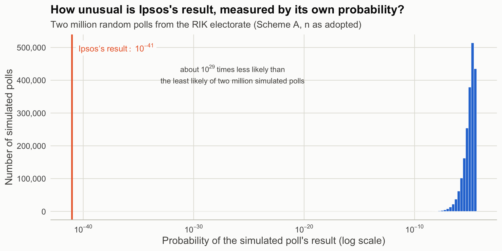
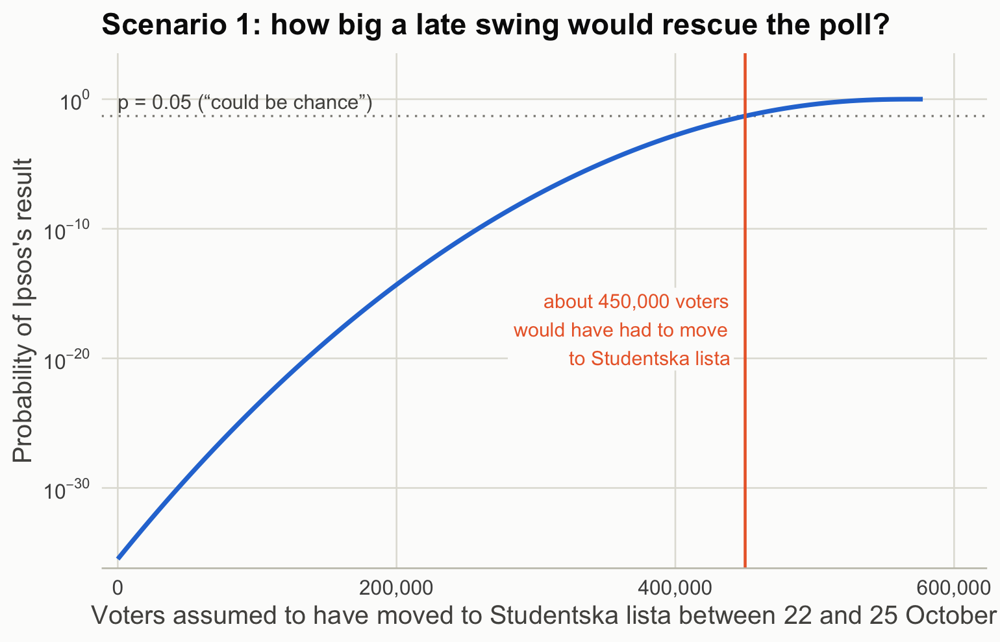
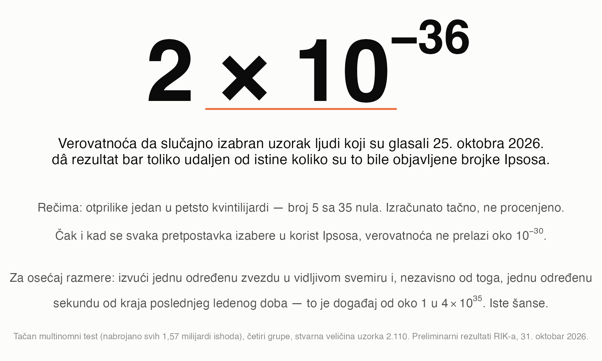
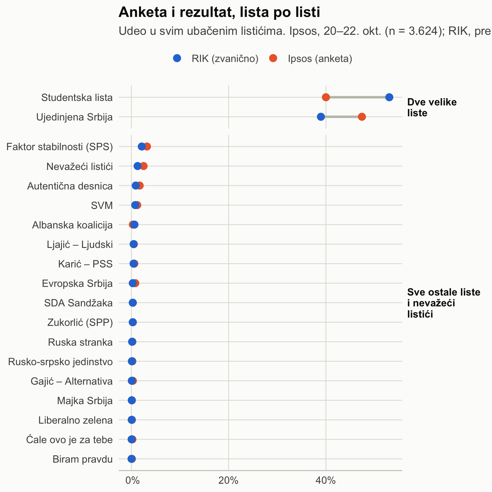
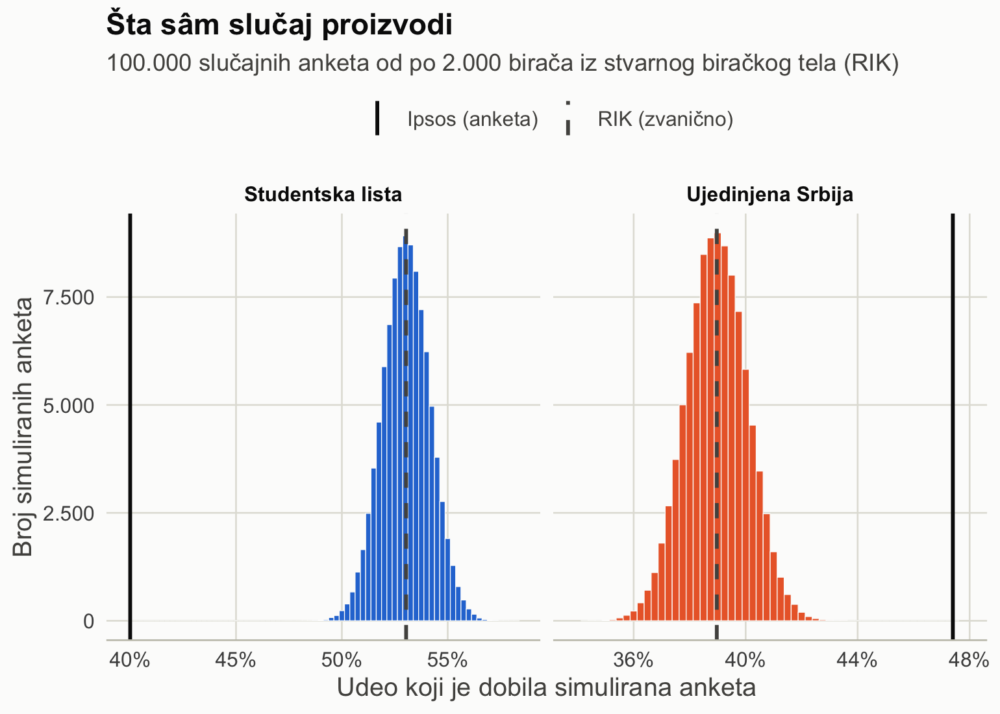
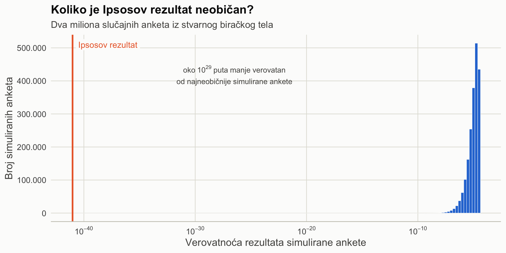
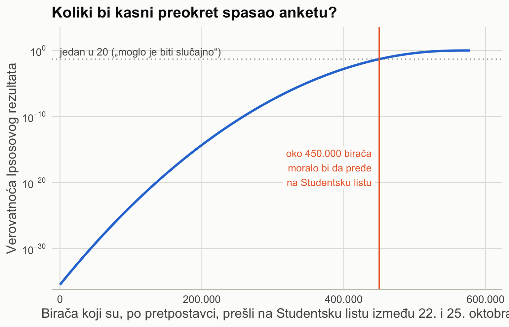

# Could Ipsos Have Obtained Its Numbers by Chance?
### Da li je Ipsos svoje brojke mogao dobiti slučajno?

A statistical analysis of the final Ipsos pre-election poll (22 October 2026) against the official results of the Serbian parliamentary elections of 25 October 2026.

**Author:** Goran S. Milovanović, PhD · [goran.s.milovanovic@gmail.com](mailto:goran.s.milovanovic@gmail.com) · [LinkedIn](https://www.linkedin.com/in/gmilovanovic/)

---

[English](#english) · [Srpski](#srpski)

---

## English


# 2 × 10<sup>−36</sup>

### What this number means

That is the probability that a **random sample of the people who actually voted** on 25 October 2026 would produce a result **at least as far from the truth** as the numbers Ipsos published three days before the vote. In words: about **one in five hundred decillion**, a 5 followed by 35 zeros.

It is exact, not an estimate: it was obtained by listing all 1.57 billion possible outcomes of a poll of that size and adding up the probabilities of those at least as far from the truth as Ipsos's. Every assumption in the analysis can also be pushed in Ipsos's favour at once: the smallest sample size its own margins of error allow, invalid ballots removed from the comparison, all lists kept separate, the textbook approximation instead of the exact test. **Even then the probability never rises above about 10<sup>−30</sup>** — one in a nonillion, a 1 followed by 30 zeros.

Numbers this small have no everyday meaning, so here are some comparisons with astronomical quantities:

| Event | Odds | Compared with Ipsos's result |
|---|---|---|
| Pick, at random, one **specific star** out of all ~10<sup>24</sup> stars in the observable universe | 1 in 10<sup>24</sup> | about **500,000,000,000 times more likely** |
| Pick one **specific star** in the observable universe *and*, independently, one **specific second** out of all the seconds since the end of the last Ice Age (~11,700 years ≈ 3.7 × 10<sup>11</sup> seconds) | 1 in 4 × 10<sup>35</sup> | **the same odds** |
| Pick one **specific grain of sand** from all the sand on Earth (~7.5 × 10<sup>18</sup> grains) *and*, independently, one **specific second** out of all the seconds since the Big Bang (~4.4 × 10<sup>17</sup>) | 1 in 3 × 10<sup>36</sup> | about **7 times less likely** than Ipsos's result |
| Pick one specific star *and* one specific minute of the year | 1 in 5 × 10<sup>29</sup> | roughly the **Ipsos-friendliest bound**, 10<sup>−30</sup> |

What this does **not** say: *why* the gap exists. See [What the findings do and do not mean](#what-the-findings-do-and-do-not-mean).

### What this repository contains

Three documents, each rendered to a self-contained HTML file (open the `.html` files in any browser; no installation needed):

| File | What it is |
|---|---|
| [`Ipsos-Izbori-2026.Rmd`](Ipsos-Izbori-2026.Rmd) → [`Ipsos-Izbori-2026.html`](Ipsos-Izbori-2026.html) | **Technical report (English).** The full analysis: data with provenance, every statistical concept explained before it is used, five independent methods, sensitivity analyses, "what would it take" scenarios, references. All code included (hidden behind *Code* buttons). |
| [`Ipsos-Izbori-2026-SR.Rmd`](Ipsos-Izbori-2026-SR.Rmd) → [`Ipsos-Izbori-2026-SR.html`](Ipsos-Izbori-2026-SR.html) | **Summary for the public (Serbian).** A compact, non-technical version in the simplest possible language, with all figures and all essential numbers. The Serbian report links to the English technical report for details. |
| [`Ipsos-Izbori-2026.ipynb`](Ipsos-Izbori-2026.ipynb) → [`Ipsos-Izbori-2026-py.html`](Ipsos-Izbori-2026-py.html) | **Technical report, Python edition.** A 1:1 translation of the R technical report into a Jupyter notebook (numpy/scipy/pandas/plotnine): same chunks, same narrative, same figures and tables. The only differences are in the stochastic simulations, which use a different random-number generator; the exact and asymptotic results agree to the digit. |

All three documents compute every number from the same data. Two kinds of numbers appear in them:

- **Exact, deterministic results** — the headline (the exact multinomial test, obtained by enumerating all 1.57 billion possible outcomes of the poll), the binomial tails, the joint tail, the chi-square approximations, the effective sample size and all "what would it take" scenarios. These involve no randomness and are **identical to the last digit** in the R and Python editions, and in the Serbian summary.
- **Simulation results** — Figure 3 (100,000 random polls), the Monte Carlo floor (2,000,000 random polls) and the importance-sampling estimate. These depend on random numbers, and R and Python use different random-number generators that cannot be seeded to produce the same draws, so these figures **differ slightly between the two technical reports** (for example, the most extreme simulated poll in Figure 3, or 3 × 10<sup>−37</sup> versus 2 × 10<sup>−37</sup> for importance sampling). The differences are of the size Monte Carlo noise produces and never affect a conclusion. The Serbian summary takes its simulation figures from the R edition.

### The question

Three days before the vote, Ipsos Strategic Marketing published its final estimate: *Aleksandar Vučić – Ujedinjena Srbija* 47.4%, *Studentska lista* 40.0% (n = 3,624; commissioned by the *Ujedinjena Srbija* list). The official count by the Republic Electoral Commission (RIK) was *Studentska lista* 53.0%, *Ujedinjena Srbija* 39.0%.

The analysis treats the official result as the true composition of the electorate and asks: **how probable is it that a properly conducted random sample of the people who voted would produce Ipsos's numbers?**

### Main findings

- The gap (13.0 points on one list, 8.4 on the other) is about **12 and 8 standard deviations** of a poll of Ipsos's effective size (≈ 2,110 decided respondents, derived from Ipsos's own published margins of error — the most generous choice for Ipsos).
- The probability that random sampling produces a result at least this far from the truth is about **2 × 10<sup>−36</sup>** (exact multinomial test, all possible outcomes enumerated); every other method and every variant tried lands between **10<sup>−30</sup> and 10<sup>−36</sup>**. Among two million simulated random polls from the real electorate, none came close.
- By Ipsos's **own** published margin of error, the true *Studentska lista* share lay 10.9 points outside the top of its 95% interval.
- The conclusion does not depend on the assumed sample size (1,500 to 3,624), on whether Kosovo i Metohija and the diaspora are excluded, or on whether invalid ballots are included in the base.
- **What would it take to rescue the poll:** a late swing of about **450,000 voters** to *Studentska lista* within three days; or, if every one of the ~275,000 unexpected extra voters had voted *Studentska*, a further ~300,000 still switching; or a quarter of voters undecided and then voting 92% for one list — and even then the small-list excess remains unexplained.
- The only other published poll (NSPM, fieldwork 25 September – 5 October) also missed in the same direction, but Ipsos's result is about 10<sup>24</sup> times less probable than NSPM's.

### The findings in four pictures

**1. Where the poll put each list, and where the voters did.** The sixteen small lists are close; the entire miss is in the two large lists.



**2. What chance alone produces.** 100,000 simulated random polls of 2,000 voters from the real electorate. Ipsos's published shares (solid black lines) lie far outside everything chance produced.



**3. How unusual Ipsos's result is, measured by its own probability.** Two million simulated random polls; Ipsos's result is about 10<sup>29</sup> times less likely than the least likely of them.



**4. How big a late swing would rescue the poll.** About 450,000 voters would have had to move to *Studentska lista* between 22 and 25 October for Ipsos's result to be an ordinary 1-in-20 unlucky draw.



All figures, including the effective-sample-size derivation, the sensitivity analysis and the sampling cloud, are in the technical report; the PNG files are in [`_img/`](_img/).

### What the findings do and do not mean

Sampling error alone **cannot** account for the gap. The analysis does **not** establish *why* the gap exists. The remaining explanations — a very large late swing, a turnout or undecided-voter shift of unusual size, a methodological bias well beyond the other poll's, or the published numbers not reflecting what the survey measured — cannot be separated by statistics, nor can any of them be separated from misreporting. The reports make no claim about intent. Resolving the question requires Ipsos's raw data, weighting scheme, likely-voter model and treatment of undecided respondents.

### Data

- Ipsos Strategic Marketing, press release of 22 October 2026 ([web](https://www.ipsos.com/sr-rs/rezultati-istrazivanja-pred-parlamentarne-izbore-oktobar-2026)).
- Republička izborna komisija, [results portal](https://www.rik.parlament.gov.rs/542645/rezultati/), snapshot of 31 October 2026, 11:00 CET (8,339 of 8,392 polling stations; **preliminary**). Regional sub-totals for Kosovo i Metohija and abroad from the same portal.
- NSPM, *Srbija, jesen 2026 (I)*, fieldwork 25 September – 5 October 2026.

All inputs are hard-coded in Section 3 of the technical report, with provenance. When RIK publishes the final results, re-enter them there and re-knit; every number in both reports updates automatically.

### Reproducing

R ≥ 4.4 with `rmarkdown`, `knitr`, `pmultinom`, `ggplot2`, `dplyr`, `tidyr`, `tibble`, `purrr`, `kableExtra`, `scales` (the technical report installs any missing package on first knit). Then:

```r
rmarkdown::render("Ipsos-Izbori-2026.Rmd")
rmarkdown::render("Ipsos-Izbori-2026-SR.Rmd")
```

Knitting takes about ten minutes (an exhaustive enumeration of 1.57 billion poll outcomes, two Monte Carlo simulations of 2 million polls and an importance-sampling run of 10 million). Results are seeded and reproducible. Knit in a UTF-8 locale so that Serbian diacritics render correctly.

Python edition (Python ≥ 3.11):

```bash
python3 -m venv .venv && . .venv/bin/activate && pip install -r requirements.txt
```

```bash
jupyter nbconvert --to notebook --execute --inplace Ipsos-Izbori-2026.ipynb
```

```bash
jupyter nbconvert --to html --TagRemovePreprocessor.enabled=True --TagRemovePreprocessor.remove_input_tags='{"hide-input"}' --HTMLExporter.exclude_input_prompt=True --HTMLExporter.exclude_output_prompt=True --output Ipsos-Izbori-2026-py.html Ipsos-Izbori-2026.ipynb
```

### Citing

*Milovanović, G. S. (2026). Could Ipsos Have Obtained Its Numbers by Chance? A multinomial probability analysis of the final Ipsos pre-election poll against the official results of the 2026 Serbian parliamentary elections.* With a link to this repository.

---

## Srpski



# 2 × 10<sup>−36</sup>

### Šta ovaj broj znači

To je verovatnoća da **slučajno izabran uzorak ljudi koji su zaista glasali** 25. oktobra 2026. dâ rezultat **bar toliko udaljen od istine** koliko su to bile brojke koje je Ipsos objavio tri dana pred izbore. Rečima: otprilike **jedan u petsto kvintilijardi**, broj 5 sa 35 nula.

To nije procena nego tačan broj: dobijen je nabrajanjem svih 1,57 milijardi mogućih ishoda ankete te veličine i sabiranjem verovatnoća onih koji su bar toliko udaljeni od istine koliko i Ipsosov. Svaka pretpostavka u analizi može se istovremeno pomeriti u korist Ipsosa: najmanja veličina uzorka koju dopuštaju njegovi sopstveni rasponi greške, nevažeći listići isključeni iz poređenja, sve liste posebno, udžbenička aproksimacija umesto tačnog testa. **Čak i tada verovatnoća ne prelazi oko 10<sup>−30</sup>** — jedan u kvintilion, broj 1 sa 30 nula.

Ovako mali brojevi nemaju svakodnevno značenje, pa evo poređenja sa astronomskim veličinama:

| Događaj | Šanse | U poređenju sa Ipsosovim rezultatom |
|---|---|---|
| Nasumice izvući jednu **određenu zvezdu** od svih ~10<sup>24</sup> zvezda u vidljivom svemiru | 1 u 10<sup>24</sup> | oko **500.000.000.000 puta verovatnije** |
| Izvući jednu **određenu zvezdu** u vidljivom svemiru *i*, nezavisno od toga, jednu **određenu sekundu** od svih sekundi od kraja poslednjeg ledenog doba (~11.700 godina ≈ 3,7 × 10<sup>11</sup> sekundi) | 1 u 4 × 10<sup>35</sup> | **iste šanse** |
| Izvući jedno **određeno zrno peska** od sveg peska na Zemlji (~7,5 × 10<sup>18</sup> zrna) *i*, nezavisno od toga, jednu **određenu sekundu** od svih sekundi od Velikog praska (~4,4 × 10<sup>17</sup>) | 1 u 3 × 10<sup>36</sup> | oko **7 puta manje verovatno** od Ipsosovog rezultata |
| Izvući jednu određenu zvezdu *i* jedan određeni minut u godini | 1 u 5 × 10<sup>29</sup> | otprilike **granica najpovoljnija za Ipsos**, 10<sup>−30</sup> |

Šta ovo **ne** govori: *zašto* je razlika nastala. Videti [Šta nalazi znače, a šta ne](#šta-nalazi-znače-a-šta-ne).

### Šta se nalazi u ovom repozitorijumu

Tri dokumenta, svaki pretvoren u samostalan HTML fajl (otvorite `.html` fajl u bilo kom pregledaču; nije potrebna nikakva instalacija):

| Fajl | Šta je to |
|---|---|
| [`Ipsos-Izbori-2026.Rmd`](Ipsos-Izbori-2026.Rmd) → [`Ipsos-Izbori-2026.html`](Ipsos-Izbori-2026.html) | **Tehnički izveštaj (engleski).** Potpuna analiza: podaci sa izvorima, svaki statistički pojam objašnjen pre upotrebe, pet nezavisnih metoda, provere osetljivosti, scenariji „šta bi bilo potrebno“, literatura. Sav kod je uključen (sakriven iza dugmadi *Code*). |
| [`Ipsos-Izbori-2026-SR.Rmd`](Ipsos-Izbori-2026-SR.Rmd) → [`Ipsos-Izbori-2026-SR.html`](Ipsos-Izbori-2026-SR.html) | **Sažetak za javnost (srpski).** Kratka, netehnička verzija na najjednostavnijem mogućem jeziku, sa svim graficima i svim bitnim brojevima. Srpski izveštaj upućuje na engleski tehnički izveštaj za detalje. |
| [`Ipsos-Izbori-2026.ipynb`](Ipsos-Izbori-2026.ipynb) → [`Ipsos-Izbori-2026-py.html`](Ipsos-Izbori-2026-py.html) | **Tehnički izveštaj, Python verzija.** Prevod tehničkog izveštaja iz R-a u Jupyter beležnicu (numpy/scipy/pandas/plotnine), 1:1: isti koraci, isti tekst, isti grafici i tabele. Razlikuju se jedino stohastičke simulacije, koje koriste drugi generator slučajnih brojeva; tačni i asimptotski rezultati poklapaju se do poslednje cifre. |

Sva tri dokumenta računaju sve brojeve iz istih podataka. U njima se javljaju dve vrste brojeva:

- **Tačni, deterministički rezultati** — glavni broj (tačan multinomni test, dobijen nabrajanjem svih 1,57 milijardi mogućih ishoda ankete), binomni repovi, zajednički rep, hi-kvadrat aproksimacije, stvarna veličina uzorka i svi scenariji „šta bi bilo potrebno“. U njima nema slučajnosti i **do poslednje cifre su isti** u R i Python verziji, kao i u srpskom sažetku.
- **Rezultati simulacija** — Slika 3 (100.000 slučajnih anketa), Monte Karlo granica (2.000.000 slučajnih anketa) i procena uzorkovanjem po važnosti. Oni zavise od slučajnih brojeva, a R i Python koriste različite generatore slučajnih brojeva koji se ne mogu podesiti da daju iste izvlačenja, pa se ove brojke **malo razlikuju između dva tehnička izveštaja** (na primer najekstremnija simulirana anketa na Slici 3, ili 3 × 10<sup>−37</sup> naspram 2 × 10<sup>−37</sup> kod uzorkovanja po važnosti). Razlike su veličine Monte Karlo šuma i nikad ne menjaju zaključak. Srpski sažetak preuzima simulacione brojke iz R verzije.

### Pitanje

Tri dana pred izbore, agencija Ipsos Strategic Marketing objavila je završnu procenu: *Aleksandar Vučić – Ujedinjena Srbija* 47,4%, *Studentska lista* 40,0% (n = 3.624; naručilac: lista *Ujedinjena Srbija*). Zvanični rezultat Republičke izborne komisije (RIK): *Studentska lista* 53,0%, *Ujedinjena Srbija* 39,0%.

Analiza uzima zvanični rezultat kao stvarni sastav biračkog tela i pita: **kolika je verovatnoća da ispravno sproveden slučajan uzorak ljudi koji su glasali dâ Ipsosove brojke?**

### Glavni nalazi

- Razlika (13,0 poena za jednu i 8,4 za drugu listu) iznosi oko **12 odnosno 8 standardnih devijacija** ankete Ipsosove stvarne veličine (≈ 2.110 opredeljenih ispitanika, izvedeno iz Ipsosovih sopstvenih objavljenih raspona greške — izbor najpovoljniji za Ipsos).
- Verovatnoća da slučajan uzorak dâ rezultat bar ovoliko udaljen od istine iznosi oko **2 × 10<sup>−36</sup>** (tačan multinomni test, nabrojani svi mogući ishodi); svaki drugi metod i svaka isprobana varijanta daju između **10<sup>−30</sup> i 10<sup>−36</sup>**. Od dva miliona simuliranih slučajnih anketa iz stvarnog biračkog tela, nijedna nije ni blizu.
- Po Ipsosovom **sopstvenom** objavljenom rasponu greške, stvarni udeo *Studentske liste* bio je 10,9 poena iznad gornje granice njegovog intervala od 95%.
- Zaključak ne zavisi od pretpostavljene veličine uzorka (od 1.500 do 3.624), od toga da li se isključe Kosovo i Metohija i dijaspora, niti od toga da li se nevažeći listići računaju u osnovu.
- **Šta bi „spaslo“ anketu:** kasni preokret od oko **450.000 birača** ka *Studentskoj listi* u tri dana; ili, čak i da je svaki od ~275.000 neočekivanih dodatnih glasača glasao za *Studentsku listu*, još ~300.000 koji menjaju mišljenje; ili četvrtina neodlučnih birača koja potom glasa 92% za jednu listu — a ni tada višak kod malih lista ne može da se objasni.
- Jedina druga objavljena anketa (NSPM, terenski rad 25. septembar – 5. oktobar) takođe je promašila u istom smeru, ali je Ipsosov rezultat oko 10<sup>24</sup> puta manje verovatan od NSPM-ovog.

### Nalazi u četiri slike

**1. Gde je anketa smestila svaku listu, a gde birači.** Šesnaest malih lista je pogođeno; ceo promašaj je u dve velike liste.



**2. Šta sâm slučaj proizvodi.** 100.000 simuliranih slučajnih anketa od po 2.000 birača iz stvarnog biračkog tela. Ipsosovi objavljeni udeli (pune crne linije) su daleko izvan svega što slučaj proizvodi.



**3. Koliko je Ipsosov rezultat neobičan, meren sopstvenom verovatnoćom.** Dva miliona simuliranih slučajnih anketa; Ipsosov rezultat je oko 10<sup>29</sup> puta manje verovatan od najneobičnije među njima.



**4. Koliki bi kasni preokret spasao anketu.** Oko 450.000 birača moralo bi da pređe na *Studentsku listu* između 22. i 25. oktobra da bi Ipsosov rezultat bio obična „loša sreća“ (jedan u 20).



Svi grafici, uključujući izvođenje stvarne veličine uzorka, proveru osetljivosti i „oblak“ slučajnih anketa, nalaze se u izveštajima; PNG fajlovi su u folderu [`_img/`](_img/).

### Šta nalazi znače, a šta ne

Slučajna greška uzorka **ne može** objasniti razliku. Analiza **ne utvrđuje** *zašto* je razlika nastala. Preostala objašnjenja — veoma veliki kasni preokret, neuobičajeno veliki pomak u izlaznosti ili među neodlučnima, metodološka pristrasnost znatno veća od one u drugoj anketi, ili to da objavljene brojke ne odražavaju ono što je anketa izmerila — statistika ne može da razdvoji, niti bilo koje od njih od pogrešnog izveštavanja. Izveštaji ne iznose nikakvu tvrdnju o namerama. Razrešenje zahteva Ipsosove sirove podatke, shemu ponderisanja, model verovatnih glasača i postupanje sa neodlučnima.

### Podaci

- Ipsos Strategic Marketing, saopštenje od 22. oktobra 2026 ([veb](https://www.ipsos.com/sr-rs/rezultati-istrazivanja-pred-parlamentarne-izbore-oktobar-2026)).
- Republička izborna komisija, [portal rezultata](https://www.rik.parlament.gov.rs/542645/rezultati/), stanje 31. oktobar 2026, 11:00 (8.339 od 8.392 biračkih mesta; **preliminarno**). Regionalni zbirovi za Kosovo i Metohiju i inostranstvo sa istog portala.
- NSPM, *Srbija, jesen 2026 (I)*, terenski rad 25. septembar – 5. oktobar 2026.

Svi ulazni podaci uneti su u Odeljku 3 tehničkog izveštaja, sa izvorima. Kad RIK objavi konačne rezultate, dovoljno ih je tamo uneti i ponovo pokrenuti; svi brojevi u oba izveštaja ažuriraju se automatski.

### Ponovno pokretanje

R ≥ 4.4 sa paketima `rmarkdown`, `knitr`, `pmultinom`, `ggplot2`, `dplyr`, `tidyr`, `tibble`, `purrr`, `kableExtra`, `scales` (tehnički izveštaj sam instalira pakete koji nedostaju). Zatim:

```r
rmarkdown::render("Ipsos-Izbori-2026.Rmd")
rmarkdown::render("Ipsos-Izbori-2026-SR.Rmd")
```

Izrada traje oko deset minuta (nabrajanje 1,57 milijardi mogućih ishoda ankete, dve simulacije od po dva miliona anketa i uzorkovanje po važnosti od deset miliona). Rezultati su reproducibilni. Pokrenite u UTF-8 okruženju da bi se dijakritici ispravno prikazali.

Python verzija (Python ≥ 3.11): napravite virtuelno okruženje i instalirajte pakete iz `requirements.txt`, zatim izvršite beležnicu i izvezite je u HTML komandama navedenim u engleskom delu iznad.

### Citiranje

*Milovanović, G. S. (2026). Could Ipsos Have Obtained Its Numbers by Chance? A multinomial probability analysis of the final Ipsos pre-election poll against the official results of the 2026 Serbian parliamentary elections.* Uz link ka ovom repozitorijumu.

---

**Kontakt / Contact:** Goran S. Milovanović, PhD · [goran.s.milovanovic@gmail.com](mailto:goran.s.milovanovic@gmail.com) · [linkedin.com/in/gmilovanovic](https://www.linkedin.com/in/gmilovanovic/)
